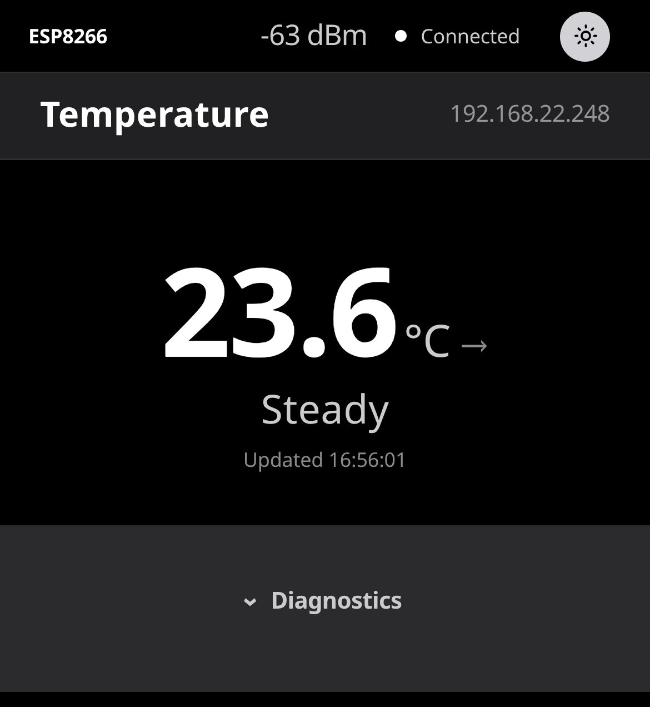

# Digital Thermometer

An ESP8266 digital thermometer with an SSD1306 OLED readout and a custom web
interface. Firmware is [ESPHome](https://esphome.io/); the web interface is
served by the device itself, so there is no dashboard, no cloud and no
external dependency at runtime.

The device answers on port 80 and pushes state over Server-Sent Events, so
the reading updates in place without polling.



## Hardware

| Part | Detail |
|---|---|
| Board | ESP8266 NodeMCU v2 |
| Sensor | DS18B20, 1-Wire, ROM `0xb9f5cd691f64ff28` |
| Display | SSD1306 OLED, 128×64, I²C address `0x3C` |
| Power | USB or VIN |

### Wiring

| Signal | Pin |
|---|---|
| 1-Wire data | GPIO2 |
| I²C SDA | GPIO4 |
| I²C SCL | GPIO5 |

Pin numbers are declared once as `substitutions` at the top of
`digital-thermometr-1.yaml`; the UI assets do not hardcode them.

## What it does

**On the OLED** — local time (SNTP, with Home Assistant as a second source),
a large temperature with a trend glyph, a heartbeat dot and the device IP.

**On the web interface**

- the reading is the interface: one large number, nothing competing with it;
- a trend word (`Rising` / `Falling` / `Steady`) derived on the client using
  the same 0.1 °C threshold the firmware lambda uses;
- live connection state with a liveness dot that pulses on every incoming
  sensor reading, so a device that stops publishing stops blinking;
- signal strength;
- everything diagnostic — RSSI, uptime, board, ROM code, pinout, host, and the
  reset reason of the current boot — sits in a **Diagnostics** disclosure
  that is closed on first load;
- light and dark appearance, defaulting to the system preference with a
  manual override that persists;
- no CDN, no web fonts, no analytics. The page is three small files served
  from the device's own flash.

## Repository layout

| File | Purpose |
|---|---|
| `digital-thermometr-1.yaml` | Firmware config: sensors, display, WiFi, web server |
| `thermometr_ui.css` | Interface styling, driven entirely by design tokens |
| `thermometr_ui.js` | Interface behaviour: DOM, SSE stream, theme, trend |
| `deploy.sh` | Sync, compile and OTA-upload via the build host |
| `infrastructure.md` | Build host topology and deployment workflow |
| `DESIGN.md` | The design language the interface implements |
| `secrets.example.yaml` | Template for the credentials you must supply |

`DESIGN.md` is a token-level design system (Apple-style: one accent colour,
no shadows, a fixed type ladder, defined breakpoints). Every colour, radius
and spacing step in `thermometr_ui.css` is a token declared once in `:root`;
there are no inline hex values in component rules, and the dark theme is a
token inversion rather than a second set of rules.

## Getting started

### 1. Credentials

```bash
cp secrets.example.yaml secrets.yaml
```

Fill in `wifi_ssid`, `wifi_password`, `api_key` and `ap_password`.
`secrets.yaml` is git-ignored. Generate an API key with:

```bash
esphome config --show-secrets dummy.yaml
```

The build fails without `api_key` — the firmware references it as
`!secret api_key`. `ap_password` backs the fallback access point that the
captive portal needs in order to be reachable at all.

### 2. Point the deploy script at your host

The script expects ESPHome to run in a Docker container on a build host. See
[infrastructure.md](infrastructure.md) for the details and for how to check
which host directory the container actually mounts.

```bash
ESPHOME_HOST=you@build-host \
REMOTE_CONFIG=/path/to/esphome/config \
DEVICE_IP=192.168.1.50 \
./deploy.sh
```

### 3. Build and flash

```bash
./deploy.sh              # compile + OTA upload
./deploy.sh --compile    # compile only
```

The first build fetches the three Google Fonts (`Roboto`, `Bebas Neue`,
`Open Sans`) that the OLED rendering uses, so the build host needs internet
access. The web interface itself does not.

Compilation is the only automated validation in this project — there is no
test suite. A successful build reports the flash and RAM budget, which is
worth watching on the ESP8266:

```
RAM:   53.2% (used 43612 bytes from 81920 bytes)
Flash: 48.0% (used 500873 bytes from 1044464 bytes)
```

**Recovery paths.** The device is reachable three ways, in order of preference:
the native API for Home Assistant, OTA over the encrypted channel, and — if
the encryption key is ever lost — plain HTTP upload at
`http://<device-ip>/update`. That last one is why `web_server`'s OTA platform
is deliberately left enabled even though ESPHome warns that it does not
benefit from OTA encryption. If the device cannot join your network at all, the
fallback access point (`wifi: ap:`) comes up and the captive portal can serve
the WiFi credentials.

## Troubleshooting

**"connection dropped immediately after encrypted hello" on the native API.**
This reads like a key mismatch and is not. Check the device's own log first —
with `web_server: log: true` the stream at `/events` shows
`[W][api:271]: Max connections (N), rejecting <ip>`. The API server has a
fixed number of slots (4 by default on the ESP8266, each costing 500–1000
bytes) and every long-lived client holds one: the dashboard, the editor
integration, Home Assistant, `esphome logs`. This repo raises the limit to 8
with `api: max_connections`. If it still happens, a client is reconnecting in a
loop — restart the dashboard or editor integration rather than touching the
key.

## How the web interface stays in sync with the firmware

Two details are worth knowing before you edit `thermometr_ui.js`.

**Entity identifiers are normalised.** ESPHome 2026.9 changed the shape of
the identifiers published by the web server — `sensor/temperature` replaced
`sensor-temperature`, and entity names are no longer sanitised
(`sensor/WiFi Signal`). The UI runs `entityKey()` over every incoming id so
it works against both the current and the previous scheme, and against
sub-device prefixes.

**The firmware must actually be recompiled.** `esphome upload` invokes
PlatformIO with `-t upload -t nobuild` and ships whatever `firmware.bin` is
already in the build directory. Editing `thermometr_ui.js` or the CSS and
then uploading alone changes nothing on the device. `deploy.sh` therefore
runs `esphome compile` as an explicit step.

## Known issues

- **The sensor reading drifts away from room temperature the longer the device
  runs.** Freshly booted the DS18B20 reads a plausible 25.4–26.6 °C. Left
  running for hours it climbs to 59–92 °C and stays there. Measured on this
  hardware:

  | Condition | Result |
  |---|---|
  | Baseline, 5 s read interval, 8 min | 26.25 → 26.00 °C (−1.9 °C/hour) |
  | Experiment, 1 s read interval (5×), 7 min | 25.62 → 25.50 °C, flat |

  Raising the read rate five times changed nothing, so this is **not** the
  sensor drawing current on the 1-Wire bus for its own conversions. The effect
  is time-dependent rather than rate-dependent, which points at the 3.3 V rail
  sagging under load — the ESP8266 draws hundreds of milliamps while
  transmitting and the sensor sits on the same rail — or heat soak from the
  regulator into a sensor mounted close to the board. A DS18B20 run below its
  ~1.1 V floor also reports garbage-high values, and a brown-out would be a
  plausible companion cause for the spontaneous reboots below. Settle this at
  the hardware level: measure supply voltage under load, then re-check.
- **The device reboots on its own every few hours**, with no OTA in flight and
  nothing in the logs before it. The config carries the default
  `wifi: reboot_timeout: 15min`, so a WiFi association that fails for 15
  minutes triggers a reboot, and the signal sits around −67 dBm. The `debug`
  component is enabled in the firmware specifically to report the reset reason
  at boot — that information exists only during the boot that caused it and
  cannot be recovered afterwards. The `Reset Reason` text sensor publishes the
  same value continuously from `ESP.getResetReason()`, which is what the web
  interface shows under Diagnostics; it reads RTC memory, so it stays valid for
  the whole boot. After an OTA upload it reads `Software/System restart` by
  definition — only an unexplained reboot tells you something. Home Assistant
  can raise a notification on the reasons you do not expect.
- **The OTA link is degrading.** A normal upload of this firmware takes about
  7 seconds; one attempt on 2026-10-17 failed outright with
  `ERROR receiving chunk result: Unknown error from ESP`, and the retry took
  145.8 seconds to transfer the same 513 KB. That is a 20× swing on a
  connection the device itself reports as `Fair` (−66 dBm), and it is the
  strongest evidence so far that the problem is in the radio or the supply
  rather than in the firmware.
- **One ESPHome warning remains**, and it is a deliberate trade:
  `OTA encryption does not cover the web_server OTA platform; its plaintext
  /update endpoint accepts the same image`. Keeping that endpoint enabled is
  what guarantees a remote recovery path if the encryption key is ever lost.
  Set `web_server: ota: false` to silence it, at the cost of that path.

**Checking firmware freshness.** The `compiled on <date>` line in the device
log is not a reliable check: ESPHome derives it from a hash of the YAML alone,
so it stays frozen across rebuilds that only change `thermometr_ui.js` or the
CSS. Compare bytes instead — fetch `/0.js` from the device and hash it against
the repository file.

## Credits

The OLED fonts are Google Fonts — *Roboto*, *Bebas Neue* and *Open Sans* —
used under the SIL Open Font License. ESPHome fetches and rasterises them at
compile time.
